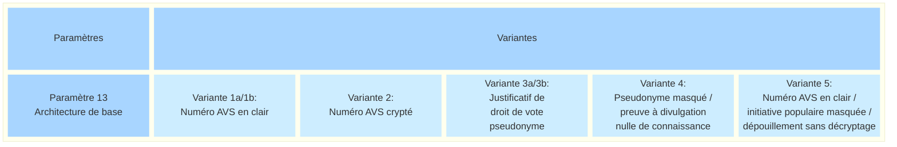
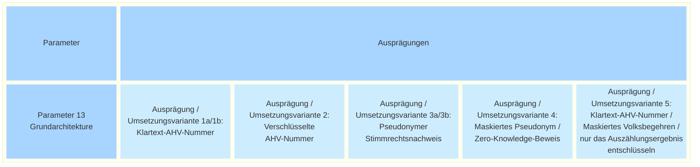

_[Deutsche Version](#d-0)_

## Boîte morphologique : Paramètre 13 - Architecture de base 

Le paramètre « Architecture de base » revêt une importance particulière en raison de sa complexité et de son impact sur les ressources financières et humaines, la sécurité, le calendrier de préparation des essais et, par conséquent, sur le soutien politique dont bénéficient ces essais. C'est pourquoi ce sujet est traité dans un document de travail distinct. Une première version de ce document a été publiée le 2 juillet 2026 sur la plateforme participative sous le titre « [Document de travail Architecture de base](https://github.com/swiss/e-collecting/raw/refs/heads/main/docs/morphological-box/parameter-13-base-architecture-working-document-FR.pdf) »  et a été examinée dans le cadre du processus participatif. Le présent document « [E-Collecting Architecture de base](https://github.com/swiss/e-collecting/raw/refs/heads/main/docs/morphological-box/parameter-13-e-collecting-base-architecture-DE.pdf) » tient compte des nouveaux enseignements acquis. En particulier, les variantes 1 et 3 ont été subdivisées respectivement en sous-variantes 1a/1b et 3a/3b.

Les sept variantes ont été définies sur la base du hackathon et des discussions qui en ont découlé dans le cadre du processus participatif. Les propositions issues du hackathon qui ne concernent pas l'architecture de base seront prises en compte dans d'autres contextes en vue d'une mise en œuvre concrète de la récolte électronique de signatures.

Dans les variantes de mise en œuvre 1a, 1b et 2, le droit de vote est attesté sur la base d’informations personnelles transmises avec la déclaration de soutien (p. ex. numéro AVS). Le déroulement s’inspire ainsi du processus actuel, sur support papier. Dans la variante 1a, le système de récolte électronique reçoit les informations d’identité sous une forme lisible et les transmet au registre électoral pour attestation. Dans la variante 1b, le numéro AVS est également utilisé, mais c’est un pseudonyme dérivé de celui-ci qui est enregistré. Dans la variante 2, le numéro AVS est transmis sous forme chiffrée, de sorte que seul le registre électoral peut le lire et l’utiliser pour la vérification du droit de vote.

Dans les variantes de mise en œuvre 3a, 3b et 4, le droit de vote est vérifié en amont et, selon la mise en œuvre retenue, également dans la variante de mise en œuvre 5. Il s’agit là d’une différence fondamentale par rapport au processus actuel, basé sur le papier. Les personnes dont le droit de vote a été vérifié avec un résultat positif se voient attribuer, dans le cadre de la certification, un pseudonyme (éventuellement structuré de manière similaire à un numéro AVS). Les informations transmises avec la déclaration de soutien s’appuient sur ce pseudonyme et attestent du droit de vote sans qu’une vérification supplémentaire dans le registre électoral ne soit nécessaire. Dans la variante 3a, le système de récolte électronique reçoit le pseudonyme sous une forme lisible et les justificatifs sont gérés au sein de l’infrastructure de confiance de l’e-ID. La variante 3b recourt à une gestion des justificatifs indépendante de l’infrastructure de confiance de l’e-ID, afin de permettre des fonctionnalités supplémentaires ainsi qu’une évolution ultérieure vers la variante 4 ou 5. L’e-ID pourrait néanmoins continuer à être utilisée pour l’authentification des personnes disposant du droit de vote. Dans la variante de mise en œuvre 4, le système de récolte électronique reçoit des preuves à divulgation nulle de connaissance basées sur le pseudonyme. Le pseudonyme n’est alors pas transmis sous une forme lisible. Cela permet de publier les déclarations de soutien sans porter atteinte au secret du vote. Elles peuvent ensuite être vérifiées et comptabilisées publiquement. Les preuves à divulgation nulle de connaissance attestent du droit de vote d’une personne sans révéler son pseudonyme. Il s’agit d’une catégorie de techniques particulièrement utilisées dans le cadre du vote électronique afin de répondre à des exigences élevées en matière de transparence tout en garantissant le secret du vote.

La variante de mise en œuvre 5 adopte une approche cryptographqiue différente pour atteindre le même objectif que la variante 4. Les déclarations de soutien sont transmises sous une forme illisible. Elles peuvent ainsi être publiées et le résultat du dépouillement peut être vérifié publiquement.

Le document de travail comporte désormais une mise en perspective des sept variantes de mise en œuvre au regard de l’utilisation de l’infrastructure de confiance de l’e-ID. Il montre que l’e-ID peut être utilisée indépendamment de l’architecture de base retenue et que les différentes variantes se distinguent principalement par l’effort de développement supplémentaire nécessaire à la mise en œuvre des fonctionnalités spécifiques à la récolte électronique de signatures.

**La discussion sur l'architecture de base a lieu [ici](https://github.com/swiss/e-collecting/issues/28).**

Lien: [Document de travail](https://github.com/swiss/e-collecting/raw/refs/heads/main/docs/morphological-box/parameter-13-base-architecture-working-document-FR.pdf) (vieux) \
Lien: [E-Collecting Architecture de base (allemand)](https://github.com/swiss/e-collecting/raw/refs/heads/main/docs/morphological-box/parameter-13-e-collecting-base-architecture-DE.pdf) (neuf)

## <a name="d-0"> Morphologischer Kasten: Parameter 13 - Grundarchitektur

Der Parameter «Grundarchitektur» hat aufgrund seiner Komplexität und seiner Bedeutung für die finanziellen und personellen Aufwände, die Sicherheit, den zeitlichen Fortschritt bei der Vorbereitung der Versuche und damit für den politischen Rückhalt der Versuche per se eine besondere Bedeutung. Deshalb wird er im in einem gesonderten Arbeitspapier behandelt. Eine erste Version dieses Dokuments wurde unter dem Titel «[Arbeitspapier Grundarchitektur](https://github.com/swiss/e-collecting/raw/refs/heads/main/docs/morphological-box/parameter-13-base-architecture-working-document-DE.pdf)» am 2. 2026 Juli auf der E-Collecting-Partizipationsplattform veröffentlicht und im Rahmen des partizipativen Prozesses behandelt. Das vorliegende Dokument [E-Collecting Grundarchitektur](https://github.com/swiss/e-collecting/raw/refs/heads/main/docs/morphological-box/parameter-13-e-collecting-base-architecture-DE.pdf) bildet die neuen Erkenntnisse ab. Insbesondere wurden die bisherigen Varianten 1 und 3 in die Untervarianten 1a/1b beziehungsweise 3a/3b aufgeteilt.

Die sieben Ausprägungen wurden auf der Grundlage des Hackathons und der darauf basierenden Gespräche im Rahmen des partizipativen Prozesses definiert. Vorschläge aus dem Hackathon, die nicht die Grundarchitektur beschlagen, werden in anderen Zusammenhängen mit Blick auf die konkrete Umsetzung von E-Collecting weiterverfolgt.

In Umsetzungsvarianten 1a, 1b und 2 wird das Stimmrecht gestützt auf persönliche Informationen bescheinigt, die mit der Unterstützungsbekundung mitgeschickt werden (z.B. AHV-Nummer). Der Ablauf orientiert sich damit am aktuellen, papierbasierten Prozess. In Variante 1a erhält das E-Collecting-System die Informationen über die Identität in lesbarer Form und leitet sie ans Stimmregister zur Bescheinigung weiter. In Variante 1b wird zwar ebenfalls die AHV-Nummer verwendet, gespeichert wird jedoch ein davon abgeleitetes Pseudonym. In Variante 2 wird die AHV-Nummer verschlüsselt übermittelt, sodass nur das Stimmregister sie lesen und zur Stimmrechtsprüfung verwenden kann.

In Umsetzungsvarianten 3a, 3b und 4 wird das Stimmrecht vorgelagert geprüft, je nach Umsetzung auch in Umsetzungsvariante 5. Darin besteht eine elementare Abweichung vom aktuellen, papierbasierten Prozess. Personen, deren Stimmrecht mit positivem Ergebnis geprüft wurde, wird im Rahmen der Bescheinigung ein Pseudonym (ev. ähnlich aufgebaut wie eine AHV-Nummer) zugewiesen. Die mit der Unterstützungsbekundung mitgeschickten Informationen stützen sich auf das Pseudonym und belegen das Stimmrecht, ohne dass eine weitere Überprüfung im Stimmregister nötig ist. In Variante 3a erhält das E-Collecting-System das Pseudonym in lesbarer Form und die Nachweise werden innerhalb der E-ID-Vertrauensinfrastruktur verwaltet. Variante 3b verwendet eine von der E-ID-Vertrauensinfrastruktur unabhängige Verwaltung der Nachweise, um zusätzliche Funktionen und eine spätere Weiterentwicklung in Richtung Variante 4 oder 5 zu ermöglichen. Die E-ID könnte weiterhin zur Authentisierung der Stimmberechtigten eingesetzt werden.In Umsetzungsvariante 4 erhält das E-Collecting-System Zero-Knowledge-Beweise auf Basis des Pseudonyms. Das Pseudonym wird dabei nicht in lesbarer Form übermittelt. Dadurch können Unterstützungsbekundungen veröffentlicht werden, ohne das Stimmgeheimnis zu verletzen. Anschliessend können sie öffentlich geprüft und gezählt werden. Die Zero-Knowledge-Beweise beweisen das Stimmrecht einer Person, ohne das Pseudonym offenzulegen. Es handelt sich um eine Klasse von Techniken, die insbesondere für E-Voting zum Einsatz kommt, um hohen Ansprüchen an Transparenz unter gleichzeitiger Gewährung des Stimmgeheimnisses gerecht zu werden.

Umsetzungsvariante 5 verfolgt einen anderen kryptographischen Ansatzmit ähnlicher Zielsetzung wie Umsetzungsvariante 4. Die Unterstützungsbekundungen werden in nicht lesbarer Form übermittelt. Dadurch können sie veröffentlicht werden und das Ergebnis der Auszählung kann öffentlich geprüft werden.

Neu enthält das Arbeitspapier eine Einordnung der sieben Umsetzungsvarianten im Hinblick auf die Nutzung der E-ID-Vertrauensinfrastruktur. Dabei wird aufgezeigt, dass die E-ID unabhängig von der gewählten Grundarchitektur eingesetzt werden kann und sich die Varianten hauptsächlich hinsichtlich des zusätzlichen Entwicklungsaufwands für E-Collecting-spezifische Funktionen unterscheiden.

**Die Diskussion über die Grundarchitektur findet [hier](https://github.com/swiss/e-collecting/issues/28) statt.**

Link: [Arbeitspapier Grundarchitektur](https://github.com/swiss/e-collecting/raw/refs/heads/main/docs/morphological-box/parameter-13-base-architecture-working-document-DE.pdf) (alt) \
Link: [E-Collecting Grundarchitektur](https://github.com/swiss/e-collecting/raw/refs/heads/main/docs/morphological-box/parameter-13-e-collecting-base-architecture-DE.pdf) (neu) 

