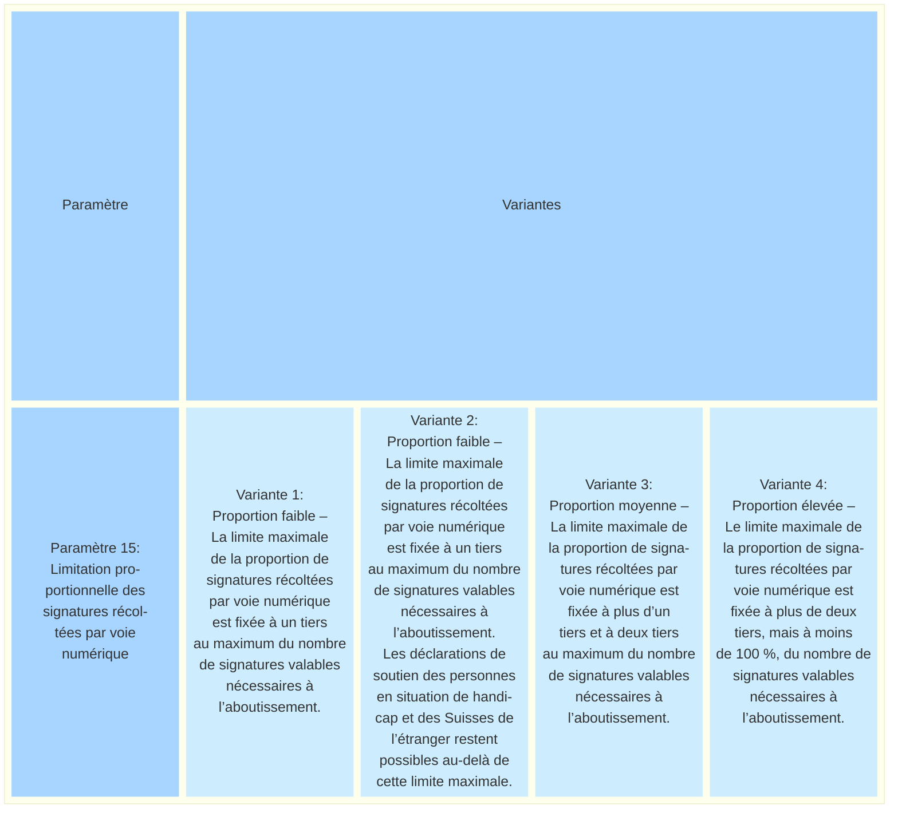
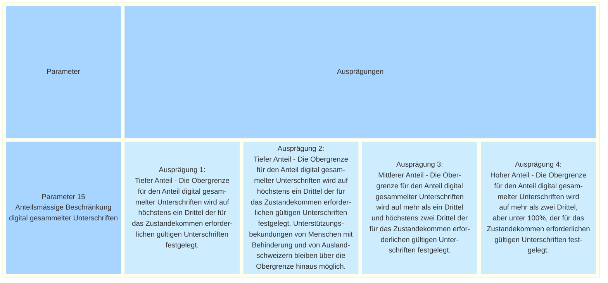

_[Deutsche Version](#d-0)_

## Boîte morphologique : Paramètre 15 - Limitation proportionnelle des signatures récoltées par voie numérique

Les Chambres fédérales demandent, dans le cadre de la révision de la loi fédérale sur les droits politiques (LDP) adoptée en juin 2026, une exploitation à titre expérimental limitée à une certaine période, à une certaine proportion et, éventuellement, à une partie du territoire (art. 84a, al. 1, LDP). La base légale prévoit que le Conseil fédéral règle les modalités de l’exploitation à titre expérimental.

La limitation proportionnelle correspond à une restriction du nombre de signatures recueillies par voie électronique. Une possibilité de mise en œuvre consisterait à fixer une limite correspondant à une certaine proportion du nombre de signatures valables nécessaires à l’aboutissement d’une initiative populaire ou d’un référendum (quorum). Le niveau de cette limite maximale influe sur la mesure dans laquelle les effets de la récolte électronique de signatures sur le système politique peuvent être étudiés dans le cadre de l’exploitation à titre expérimental. Une limite maximale basse diminue le nombre de soutiens pouvant être exprimés par voie électronique et réduit ainsi les possibilités d’acquérir de l’expérience avec le canal de récolte électronique dans différentes situations de récolte. En outre, il existe un risque que les comités et les groupements considèrent ce canal comme peu attractif et renoncent dès lors à en faire activement la promotion. L’intérêt des personnes disposant du droit de vote pour la récolte électronique de signatures pourrait également diminuer si elles constatent à plusieurs reprises qu’elles ne peuvent plus apporter leur soutien par voie électronique parce que le plafond fixé a déjà été atteint.
À l’inverse, une limite maximale élevée permettrait un recours plus large au canal numérique et favoriserait ainsi l’étude scientifique de ses effets sur le système politique. Toutefois, une proportion élevée de signatures récoltées par voie numérique pourrait entraîner des changements plus importants dans les processus de récolte des signatures que ce qui est nécessaire dans le cadre d’une exploitation à titre expérimental.

En septembre 2026, le canton de Saint-Gall a lancé une exploitation expérimentale de la récolte électronique à l’échelle cantonale, au moyen d’un système développé spécifiquement à cet effet. La part maximale autorisée de signatures récoltées par voie numérique a été fixée à 50 % du nombre de signatures nécessaires à l’aboutissement.

La question de la prise en compte éventuelle des personnes en situation de handicap et des suisses de l'étranger  hors de cette limitation proportionnelle se pose également. Dans ce cas, les déclarations de soutien de ces groupes de personnes seraient enregistrées séparément.

Du point de vue administratif, cette mesure est relativement simple à mettre en œuvre pour les Suisses de l’étranger, puisqu’ils peuvent être identifiés dans les registres des électeurs sur la base de leur domicile à l’étranger. En revanche, la prise en compte des personnes en situation de handicap est plus complexe, car les registres des électeurs ne comportent généralement pas d’informations à ce sujet. Une telle prise en compte nécessiterait donc des vérifications individuelles et des processus administratifs supplémentaires (par exemple sous la forme d’une procédure d’inscription). En outre, des critères précis devraient être adoptés afin de délimiter cette catégorie de personnes.

Lorsque la limitation proportionnelle se situe à un niveau moyen ou élevé, les personnes disposant du droit de vote devraient en principe disposer de davantage de temps pour déposer leurs déclarations de soutien par voie numérique avant que la limite maximale fixée ne soit atteinte. Cela peut notamment profiter aux personnes en situation de handicap qui ont besoin de davantage de temps pour effectuer leur démarche de soutien numérique. En revanche, lorsque la limite maximale est basse, il existe un risque qu’elle soit atteinte rapidement en cas de succès rapide de la récolte, empêchant ainsi le dépôt de nouvelles déclarations de soutien par voie numérique. La variante 2 décrite ci-dessous tient compte de cette éventualité. Si un besoin de réglementation spéciale existe au-delà de ce cas, nous invitons les participantes et participants à l’exposer et à en débattre dans le cadre du dialogue.

D’autres modalités de limitation proportionnelle sont également envisageables. Ainsi, la limitation pourrait être combinée à une restriction géographique ou être définie en fonction de la proportion des soutiens effectivement déposés, plutôt qu’en fonction du quorum requis.. Il serait également possible de prévoir une limitation fondée sur le nombre de personnes autorisées à voter, à l’échelle nationale ou au niveau des cantons et des communes.

Aucune variante concrète n’a encore été élaborée pour ces approches alternatives. Nous sommes toutefois disposés à en discuter dans le cadre du dialogue, pour autant que des arguments et des propositions correspondants soient présentés.

Les questions abordées dans ce paramètre ont également été reprises dans une proposition alternative de paramètre ([NEU Parameter N-24: «Quorum für den Anteil digital gesammelter Unterschriften»](https://github.com/swiss/e-collecting/issues/41)). La Chancellerie fédérale a adapté et complété cette proposition pour la présente publication.

Les différentes valeurs possibles de ce paramètre sont-elles, selon vous, toutes présentées ? Quelles seraient les conséquences possibles du choix de l'une de ces valeurs ? **La discussion à ce sujet a lieu [ici](https://github.com/swiss/e-collecting/issues/FIXME).**

## <a name="d-0"> Morphologischer Kasten: Parameter 15 - Anteilsmässige Beschränkung digital gesammelter Unterschriften

Die eidgenössischen Räte verlangen in der im Juni 2026 verabschiedeten Revision des Bundesgesetzes über die politischen Rechte (BPR) einen zeitlich, anteilsmässig und allenfalls örtlich begrenzten Versuchsbetrieb (Artikel 84a Abs. 1 BPR). Die gesetzliche Grundlage sieht vor, dass der Bundesrat die Einzelheiten des Versuchsbetriebs regelt.

Die anteilsmässige Beschränkung bedeutet eine mengenmässige Beschränkung der elektronisch gesammelten Unterschriften. Eine Möglichkeit für die Umsetzung wäre die Festlegung einer Limite im Sinne eines gewissen Anteils gemessen an der für das Zustandekommen einer Volksinitiative oder eines Referendums erforderlichen Anzahl gültigen Unterschriften (Quorum). Die Höhe dieser Obergrenze beeinflusst, in welchem Umfang die staatspolitischen Auswirkungen von E-Collecting im Versuchsbetrieb untersucht werden können. Eine tiefe Obergrenze schränkt die Anzahl der elektronisch möglichen Unterstützungsbekundungen ein und damit auch die Möglichkeit, Erfahrungen mit dem digitalen Sammelkanal in unterschiedlichen Sammelsituationen zu sammeln. Zudem besteht das Risiko, dass Komitees und Gruppierungen den digitalen Kanal als wenig attraktiv einschätzen und ihn deshalb nicht aktiv bewerben. Auch bei stimmberechtigten Personen könnte das Interesse an E-Collecting abnehmen, wenn sie wiederholt feststellen, dass sie eine elektronische Unterstützungsbekundung aufgrund einer bereits erreichten Obergrenze nicht mehr abgeben können.

Eine hohe Obergrenze würde demgegenüber eine breitere Nutzung des digitalen Kanals ermöglichen und damit die wissenschaftliche Untersuchung seiner staatspolitischen Auswirkungen begünstigen. Gleichzeitig könnte ein hoher Anteil digital gesammelter Unterschriften zu stärkeren Veränderungen bei den Abläufen der Unterschriftensammlung führen als für einen Versuchsbetrieb nötig.

Der Kanton St.Gallen startete im September 2026 mit einem eigens entwickelten E-Collecting-Versuchsbetrieb auf Kantonsstufe. Dabei wurde der maximal zulässige Anteil digital gesammelter Unterschriften auf 50 Prozent der für das Zustandekommen erforderlichen Unterschriften festgelegt.

Eine weitere Frage, die sich stellt, ist die allfällige Berücksichtigung von Menschen mit Behinderungen sowie Auslandschweizerinnen und Auslandschweizern ausserhalb dieser anteilsmässigen Beschränkung. Die Unterstützungsbekundungen dieser Personengruppen würden bei einer Berücksichtigung separat erfasst.

Bei Auslandschweizerinnen und Auslandschweizern ist dies aus administrativer Sicht vergleichsweise einfach umsetzbar, da sie in den Stimmregistern anhand ihres Wohnsitzes im Ausland identifiziert werden können. Bei Menschen mit Behinderungen gestaltet sich dies hingegen anspruchsvoller, da entsprechende Angaben in den Stimmregistern in der Regel nicht ausgewiesen sind. Eine entsprechende Berücksichtigung würde deshalb individuelle Abklärungen und zusätzliche administrative Prozesse erfordern (wie beispielsweise ein Anmeldeverfahren); ausserdem müssten konkrete Vorgaben zur Definition dieser Zielgruppe erlassen werden.

Bei einer anteilsmässigen Beschränkung im mittleren oder höheren Bereich haben stimmberechtigte Personen voraussichtlich mehr Zeit, um Unterstützungsbekundungen digital einzureichen, bevor die festgelegte Obergrenze erreicht ist. Dies kann insbesondere Menschen mit Behinderungen zugutekommen, die für die digitale Unterstützungsleistung mehr Zeit benötigen. Bei einer tiefen Beschränkung besteht hingegen das Risiko, dass die Obergrenze bei einem raschen Sammlungserfolg frühzeitig erreicht wird und weitere digitale Unterstützungsbekundungen nicht mehr möglich sind. Die nachfolgend beschriebene Ausprägung 2 greift diesen möglichen Fall auf. Falls über diesen Fall hinaus Bedarf für eine Sonderregelung besteht, laden wir dazu ein, diesen im Rahmen des Dialogs zu erläutern und zu diskutieren.

Schliesslich sind auch alternative Ausgestaltungen der anteilsmässigen Beschränkung denkbar. So könnte die Beschränkung mit einer örtlichen Begrenzung kombiniert werden oder sich auf den Anteil der eingereichten Unterstützungsbekundungen beziehen anstatt auf das Quorum. Denkbar wäre auch eine Begrenzung anhand der Zahl der zugelassenen Stimmberechtigten, schweizweit oder auf Ebene der Kantone und Gemeinden.

Für diese alternativen Ansätze wurden bisher keine konkreten Ausprägungen ausgearbeitet. Wir sind jedoch offen, sie im Rahmen des Dialogs zu diskutieren, sofern entsprechende Argumente und Vorschläge eingebracht werden.

Die in diesem Parameter behandelten Fragen wurden auch in einem alternativen Parametervorschlag aufgegriffen (NEU Parameter N-24: «Quorum für den Anteil digital gesammelter Unterschriften»). Die Bundeskanzlei hat den Vorschlag für die vorliegende Veröffentlichung angepasst und ergänzt.

Die in diesem Parameter behandelten Fragen wurden auch in einem alternativen Parametervorschlag der Stiftung für direkte Demokratie aufgegriffen ([NEU Parameter N-24: «Quorum für den Anteil digital gesammelter Unterschriften»](https://github.com/swiss/e-collecting/issues/41)). Die Bundeskanzlei hat den Vorschlag für die vorliegende Veröffentlichung angepasst und ergänzt.

Sind die möglichen Ausprägungen dieses Parameters aus Ihrer Sicht vollständig dargestellt? Welche möglichen Auswirkungen hätte die Auswahl einer der möglichen Ausprägungen? **Die Diskussion dazu findet [hier](https://github.com/swiss/e-collecting/issues/FIXME) statt.**

