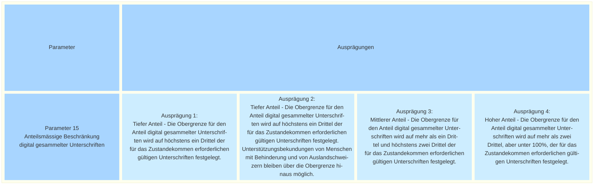

## <a name="d-0"> Morphologischer Kasten: Parameter 15 - Anteilsmässige Beschränkung digital gesammelter Unterschriften

Die eidgenössischen Räte verlangen in der im Juni 2026 verabschiedeten Revision des Bundesgesetzes über die politischen Rechte (BPR) einen zeitlich, anteilsmässig und allenfalls örtlich begrenzten Versuchsbetrieb (Artikel 84a Abs. 1 BPR). Die gesetzliche Grundlage sieht vor, dass der Bundesrat die Einzelheiten des Versuchsbetriebs regelt.

Die anteilsmässige Beschränkung bedeutet eine mengenmässige Beschränkung der elektronisch gesammelten Unterschriften. Eine Möglichkeit für die Umsetzung wäre die Festlegung einer Limite im Sinne eines gewissen Anteils gemessen an der für das Zustandekommen einer Volksinitiative oder eines Referendums erforderlichen Anzahl gültigen Unterschriften (Quorum). Die Höhe dieser Obergrenze beeinflusst, in welchem Umfang die staatspolitischen Auswirkungen von E-Collecting im Versuchsbetrieb untersucht werden können. Eine tiefe Obergrenze schränkt die Anzahl der elektronisch möglichen Unterstützungsbekundungen ein und damit auch die Möglichkeit, Erfahrungen mit dem digitalen Sammelkanal in unterschiedlichen Sammelsituationen zu sammeln. Zudem besteht das Risiko, dass Komitees und Gruppierungen den digitalen Kanal als wenig attraktiv einschätzen und ihn deshalb nicht aktiv bewerben. Auch bei stimmberechtigten Personen könnte das Interesse an E-Collecting abnehmen, wenn sie wiederholt feststellen, dass sie eine elektronische Unterstützungsbekundung aufgrund einer bereits erreichten Obergrenze nicht mehr abgeben können.

Eine hohe Obergrenze würde demgegenüber eine breitere Nutzung des digitalen Kanals ermöglichen und damit die wissenschaftliche Untersuchung seiner staatspolitischen Auswirkungen begünstigen. Gleichzeitig könnte ein hoher Anteil digital gesammelter Unterschriften zu stärkeren Veränderungen bei den Abläufen der Unterschriftensammlung führen als für einen Versuchsbetrieb nötig.

Der Kanton St.Gallen startete im September 2026 mit einem eigens entwickelten E-Collecting-Versuchsbetrieb auf Kantonsstufe. Dabei wurde der maximal zulässige Anteil digital gesammelter Unterschriften auf 50 Prozent der für das Zustandekommen erforderlichen Unterschriften festgelegt.

Eine weitere Frage, die sich stellt, ist die allfällige Berücksichtigung von Menschen mit Behinderungen sowie Auslandschweizerinnen und Auslandschweizern ausserhalb dieser anteilsmässigen Beschränkung. Die Unterstützungsbekundungen dieser Personengruppen würden bei einer Berücksichtigung separat erfasst.

Bei Auslandschweizerinnen und Auslandschweizern ist dies aus administrativer Sicht vergleichsweise einfach umsetzbar, da sie in den Stimmregistern anhand ihres Wohnsitzes im Ausland identifiziert werden können. Bei Menschen mit Behinderungen gestaltet sich dies hingegen anspruchsvoller, da entsprechende Angaben in den Stimmregistern in der Regel nicht ausgewiesen sind. Eine entsprechende Berücksichtigung würde deshalb individuelle Abklärungen und zusätzliche administrative Prozesse erfordern (wie beispielsweise ein Anmeldeverfahren); ausserdem müssten konkrete Vorgaben zur Definition dieser Zielgruppe erlassen werden.

Bei einer anteilsmässigen Beschränkung im mittleren oder höheren Bereich haben stimmberechtigte Personen voraussichtlich mehr Zeit, um Unterstützungsbekundungen digital einzureichen, bevor die festgelegte Obergrenze erreicht ist. Dies kann insbesondere Menschen mit Behinderungen zugutekommen, die für die digitale Unterstützungsleistung mehr Zeit benötigen. Bei einer tiefen Beschränkung besteht hingegen das Risiko, dass die Obergrenze bei einem raschen Sammlungserfolg frühzeitig erreicht wird und weitere digitale Unterstützungsbekundungen nicht mehr möglich sind. Die nachfolgend beschriebene Ausprägung 2 greift diesen möglichen Fall auf. Falls über diesen Fall hinaus Bedarf für eine Sonderregelung besteht, laden wir dazu ein, diesen im Rahmen des Dialogs zu erläutern und zu diskutieren.

Schliesslich sind auch alternative Ausgestaltungen der anteilsmässigen Beschränkung denkbar. So könnte die Beschränkung mit einer örtlichen Begrenzung kombiniert werden oder sich auf den Anteil der eingereichten Unterstützungsbekundungen beziehen anstatt auf das Quorum. Denkbar wäre auch eine Begrenzung anhand der Zahl der zugelassenen Stimmberechtigten, schweizweit oder auf Ebene der Kantone und Gemeinden.

Für diese alternativen Ansätze wurden bisher keine konkreten Ausprägungen ausgearbeitet. Wir sind jedoch offen, sie im Rahmen des Dialogs zu diskutieren, sofern entsprechende Argumente und Vorschläge eingebracht werden.

Die in diesem Parameter behandelten Fragen wurden auch in einem alternativen Parametervorschlag aufgegriffen (NEU Parameter N-24: «Quorum für den Anteil digital gesammelter Unterschriften»). Die Bundeskanzlei hat den Vorschlag für die vorliegende Veröffentlichung angepasst und ergänzt.

Die in diesem Parameter behandelten Fragen wurden auch in einem alternativen Parametervorschlag der Stiftung für direkte Demokratie aufgegriffen ([NEU Parameter N-24: «Quorum für den Anteil digital gesammelter Unterschriften»](https://github.com/swiss/e-collecting/issues/41)). Die Bundeskanzlei hat den Vorschlag für die vorliegende Veröffentlichung angepasst und ergänzt.

