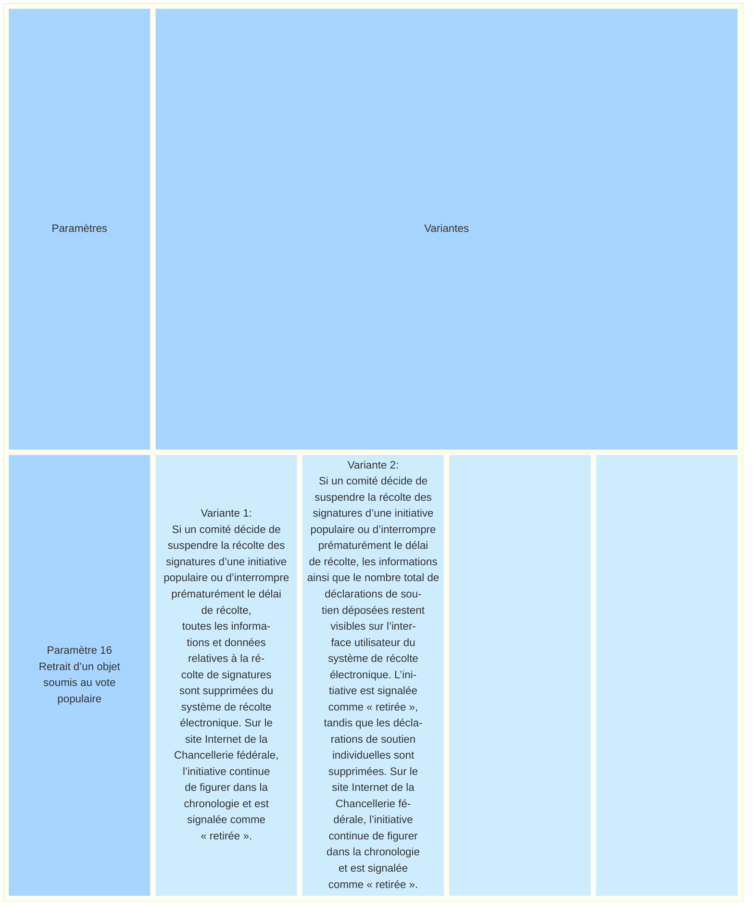
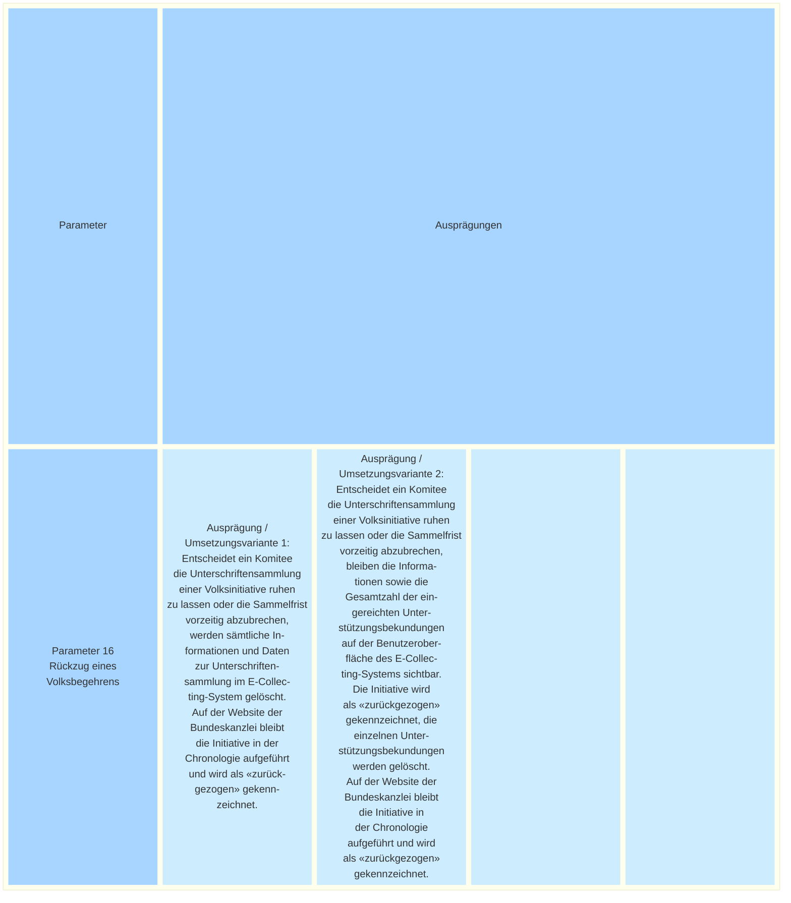

_[Deutsche Version](#d-0)_

## Boîte morphologique : Paramètre 16 - Arrêt d’un objet soumis au vote populaire

Conformément à la loi, les initiatives populaires sont portées par des comités d’initiative. Pendant la période de récolte, le comité peut décider de suspendre la collecte des signatures et de ne pas déposer les soutiens recueillis. Si le délai de récolte expire sans avoir été utilisé, l’initiative populaire est enregistrée dans la chronologie des initiatives populaires comme n’ayant pas abouti. Si le comité souhaite mettre fin prématurément à la période de récolte, il peut déposer les signatures déjà recueillies, même en nombre insuffisant. Le dépôt met fin à la période de récolte et la Chancellerie fédérale constate alors officiellement le non-aboutissement de l’initiative populaire.

La question se pose de savoir si et comment mettre en œuvre concrètement cet « arrêt » dans le cadre de la récolte électronique de signatures. L’arrêt de la récolte et la cessation de la réception de nouvelles déclarations de soutien sont en principe simples à réaliser sur le plan technique. D’un point de vue technique, la suppression des déclarations de soutien déjà déposées soulève également peu de questions.

En revanche, il reste à déterminer si, après le retrait, toutes les informations relatives à la récolte doivent être supprimées du système ou si l’initiative retirée doit rester visible en tant que telle.

Si la récolte disparaît du système, aucune nouvelle attestation de soutien ne peut être reçue. Si une liste des objets soumis au vote populaire en cours est affichée dans le système, la récolte est retirée de cette liste (voir [Paramètre 2 – Présentation des objets soumis au vote populaire en cours](https://github.com/swiss/e-collecting/issues/15)).
Si des données relatives aux récoltes électroniques sont publiées (voir [Paramètre 5 – Affichage du nombre de signatures recueillies à ce jour](https://github.com/swiss/e-collecting/issues/18)), les chiffres concernant l’initiative retirée ne sont plus affichés. Si les informations sont conservées, elles restent en revanche visibles dans le système de récolte électronique et sur l’interface utilisateur, et l’initiative populaire est signalée comme « retirée ».

Les questions abordées dans ce paramètre ont également été traitées dans une proposition alternative de paramètre (voir [NEU Parameter N-23-2 - Formeller Rückzug einer Initiative](https://github.com/swiss/e-collecting/issues/40)). La Chancellerie fédérale a adapté et complété cette proposition pour la présente publication.

**La discussion à ce sujet a lieu [ici](https://github.com/swiss/e-collecting/issues/48).**

[Edit: Le nom de ce paramètre a été modifié de "Retrait d’un objet soumis au vote populaire" à "Arrêt d’un objet soumis au vote populaire". Le texte a également été mis à jour.]

## <a name="d-0"> Morphologischer Kasten: Parameter 16 - Abbruch eines Volksbegehrens

Hinter Volksinitiativen stehen gemäss Gesetz Initiativkomitees. Während der Sammelphase können diese entscheiden, die Unterschriftensammlung ruhen zu lassen und die gesammelten Unterstützungsbekundungen nicht einzureichen. Mit unbenutztem Ablauf der Sammelfrist wird die Volksinitiative in der Chronologie Volksinitiativen als «Nicht-Zustandegekommen» erfasst. Falls das Komitee die Sammelfrist vorzeitig abbrechen will, so kann es die bisher gesammelten Unterschriften einreichen (oder auch nur eine davon). Das beendet die Sammelfrist und die Bundeskanzlei stellt dann das Nicht-Zustandekommen der Volksinitiative fest.

Es stellt sich die Frage, ob und wie dieser «Abbruch» bei E-Collecting praktisch umgesetzt wird. Die Sammlung zu stoppen und keine weiteren Unterstützungsbekundungen entgegenzunehmen, ist technisch grundsätzlich unkompliziert. Auch die Löschung der bereits geleisteten Unterstützungsbekundungen wirft technisch gesehen wenige Fragen auf.

Offen ist hingegen, ob nach dem «Abbruch» sämtliche Informationen zur Sammlung aus dem System entfernt werden oder ob die zurückgezogene Initiative weiterhin als solche sichtbar bleibt.

Verschwindet die Sammlung, werden keine neuen Unterstützungsbekundungen mehr entgegengenommen. Ist im System eine Liste von laufenden Volksbegehren sichtbar, verschwindet die Sammlung von dieser Liste (siehe [Parameter 2 – Darstellung laufender Volksbegehren](https://github.com/swiss/e-collecting/issues/15)). 
Werden Daten zu elektronischen Sammlungen publiziert (siehe [Parameter 5 – Anzeige der Anzahl bisher gesammelter Unterschriften](https://github.com/swiss/e-collecting/issues/18)), werden die Zahlen zur zurückgezogenen Initiative nicht mehr angezeigt. Bei einem Verbleib der Informationen bleiben diese hingegen im E-Collecting-System und auf der Benutzeroberfläche sichtbar, die Volksinitiative wird als «zurückgezogen» gekennzeichnet.

Die Fragen in diesem Parameter wurden auch in einem alternativen Parameter-Vorschlag (siehe [NEU Parameter N-23-2 - Formeller Rückzug einer Initiative](https://github.com/swiss/e-collecting/issues/40)) thematisiert. Die Bundeskanzlei hat den Vorschlag für die vorliegende Veröffentlichung angepasst und ergänzt.

**Die Diskussion hiezu findet [hier](https://github.com/swiss/e-collecting/issues/48) statt.**

[Edit: Der Titel dieses Parameters wurde von "Rückzug eines Volksbegehrens" zu "Abbruch eines Volksbegehrens" verändert. Der Text wurde ebenfalls nachgezogen.]

