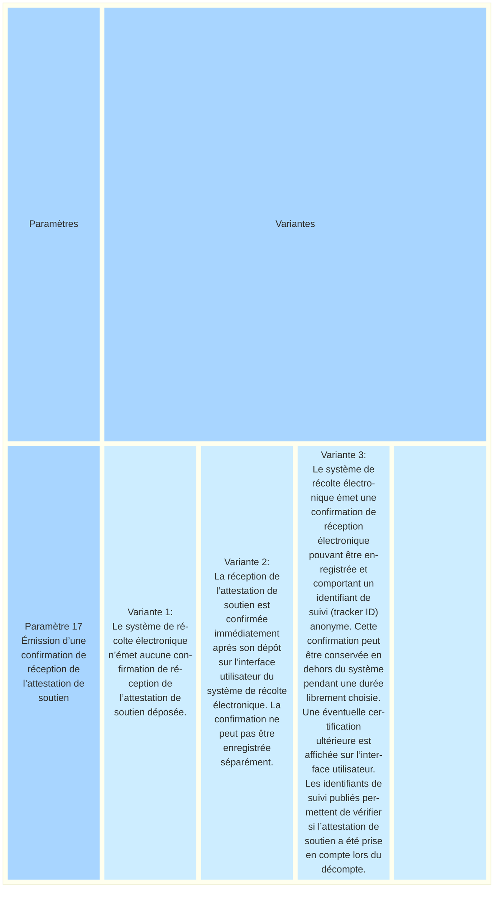
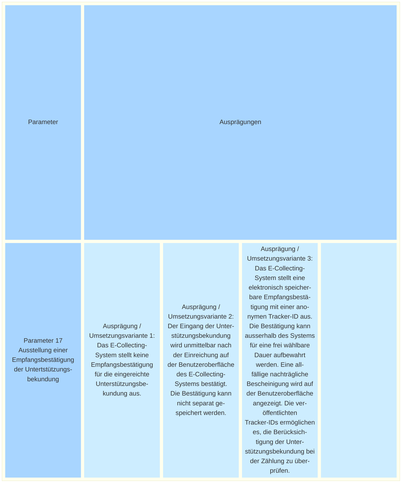

_[Deutsche Version](#d-0)_

## Boîte morphologique : Paramètre 17 - Émission d’une confirmation de réception de l’attestation de soutien

Lors de la récolte de signatures sur papier, les personnes qui signent ne reçoivent pas de confirmation individuelle indiquant quand et pour quel objet soumis au vote populaire elles ont signé. 
Ils peuvent toutefois, en vertu de leur droit d'accès, demander à l'autorité compétente chargée de la tenue du registre des électeurs de leur indiquer s'ils figurent parmi les signataires d'une initiative populaire donnée. Dans le système de la récolte électronique de signatures, la réception d’une attestation de soutien pourrait être confirmée électroniquement sans grande difficulté.

Une telle confirmation peut prendre différentes formes : elle peut être affichée uniquement sur l’interface utilisateur immédiatement après le dépôt ou faire également l’objet d’une publication.

Concernant la publication : Le document de travail « Paramètres de l’architecture de base » décrit la possibilité d’utiliser un identifiant de suivi (tracker ID) anonyme. Cette idée est étroitement liée à la confirmation de réception décrite ici et permettrait de publier les identifiants de suivi pris en compte lors du décompte. Chaque personne ayant apporté son soutien pourrait ainsi vérifier si sa signature a été comptabilisée.

Il convient également de tenir compte du fait que des confirmations pourraient être être utilisées pour démontrer à des tiers qu’une attestation de soutien a été déposée. 

Les questions abordées dans ce paramètre ont également été traitées dans une proposition alternative de paramètre ([NEU Parameter N-19 - Empfangsbestätigung](https://github.com/swiss/e-collecting/issues/34)). La Chancellerie fédérale a adapté et complété cette proposition pour la présente publication.

**La discussion sur l'architecture de base a lieu [ici](https://github.com/swiss/e-collecting/issues/49).**

## <a name="d-0"> Morphologischer Kasten: Parameter 17 - Ausstellung einer Empfangsbestätigung der Untertstützungsbekundung 

Bei der Unterschriftensammlung auf Papier erhalten die unterzeichnenden Personen keine individuelle Empfangsbestätigung darüber, wann und für welches Volksbegehren sie unterschrieben haben. Sie können jedoch gestützt auf ihr Auskunftsrecht bei der zuständigen stimmregisterführenden Stelle Auskunft darüber verlangen, ob sie für ein bestimmtes Volksbegehren als unterzeichnende Person hinterlegt sind. Im E-Collecting-System könnte der Eingang einer Unterstützungsbekundung mit wenig Aufwand unmittelbar elektronisch bestätigt werden.

Eine solche Bestätigung kann unterschiedlich ausgestaltet sein: Sie kann lediglich unmittelbar nach der Einreichung auf der Benutzeroberfläche angezeigt oder auch publiziert werden. 

Zur Publikation: Im Arbeitsdokument «Parameter Grundarchitektur» wird die Möglichkeit einer anonymen Tracker-ID beschrieben. Diese Idee ist eng mit der hier beschriebenen Empfangsbestätigung verbunden und würde es erlauben, bei der Zählung die berücksichtigten Tracker-IDs öffentlich anzuzeigen. Damit könnte jede unterstützende Person nachvollziehen, ob ihre Unterschrift mitgezählt wurde.

Neben diesen Überlegungen ist zu berücksichtigen, dass Bestätigungen verwendet werden könnten, um die Abgabe einer Unterstützungsbekundung gegenüber Dritten zu belegen. 

Die Fragen in diesem Parameter wurden auch in einem alternativen Parameter-Vorschlag ([NEU Parameter N-19 - Empfangsbestätigung](https://github.com/swiss/e-collecting/issues/34)) thematisiert. Die Bundeskanzlei hat den Vorschlag für die vorliegende Veröffentlichung angepasst und ergänzt.

**Die Diskussion über die Grundarchitektur findet [hier](https://github.com/swiss/e-collecting/issues/49) statt.**

